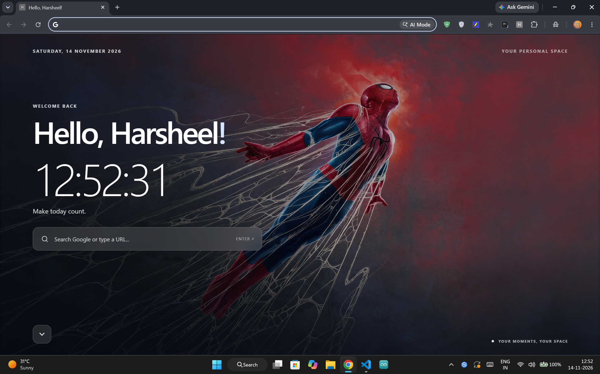
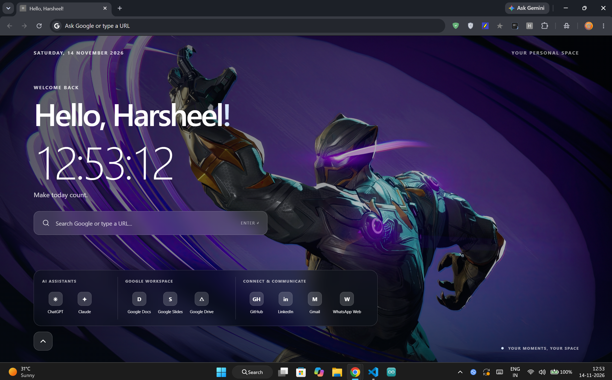

# My Chrome Homepage

A personalized Chrome New Tab experience designed to make every new tab more useful, organized, and visually appealing.

Featuring a live clock, dynamic greeting, Google search, a randomized slideshow of 103 photos, and a collapsible shortcut menu for your everyday apps.

<p align="center">
  
</p>

<p align="center">
  <strong>A personal space. A fresh start. Every new tab.</strong>
</p>

---

## Features

- **Personalized Greeting** – Welcome message that changes according to the time of day.
- **Live Clock** – Real-time digital clock in 24-hour format.
- **Dynamic Date** – Displays the current day, date, month, and year.
- **Google Search** – Search directly from your new tab.
- **103-Photo Slideshow** – Automatically rotates through a collection of 103 background images.
- **Randomized Image Order** – Starts with a random photo and shuffles the collection after every complete cycle.
- **Smooth Transitions** – Crossfade effects between background images.
- **Collapsible Shortcut Menu** – Keep your shortcuts hidden by default and expand them whenever needed.
- **Quick Access Links** – Shortcuts organized into three categories:
  - AI Assistants: ChatGPT and Claude
  - Google Workspace: Docs, Slides, and Drive
  - Connect & Communicate: GitHub, LinkedIn, Gmail, and WhatsApp Web
- **Minimal Interface** – A clean, distraction-free design with a full-screen photo background.

## Screenshots

### Homepage


### Expanded Shortcut Menu



> Screenshots are stored in the `screenshots/` directory. Replace these placeholders with actual screenshots of the extension.

## Installation

Install the extension locally using Chrome's Developer Mode.

1. Clone this repository:

   ```bash
   git clone https://github.com/Harsheel-Kumar-Sahoo/my-chrome-homepage.git
   ```

2. Open Google Chrome.

3. Navigate to:

   ```text
   chrome://extensions
   ```

4. Enable **Developer mode** using the toggle in the top-right corner.

5. Click **Load unpacked**.

6. Select the downloaded `my-chrome-homepage` project folder (the folder containing `manifest.json`).

7. Open a new tab to experience your personalized homepage.

## Project Structure

```text
my-chrome-homepage/
│
├── images/
│   ├── image-1.jpg
│   ├── image-2.jpg
│   ├── ...
│   └── image-103.jpg
│
├── screenshots/
│   ├── homepage.png
│   └── shortcuts-expanded.png
│
├── index.html
├── style.css
├── script.js
├── manifest.json
└── README.md
```

## Customization

You can personalize the extension by editing a few values in the source files.

| What to customize | Where to edit |
|---|---|
| Greeting and page title | `index.html` |
| Background images | `images/` |
| Number of slideshow images | `script.js` |
| Slideshow interval | `script.js` |
| Appearance and layout | `style.css` |
| Quick-access links | `index.html` |
| Extension name and description | `manifest.json` |

### Changing the slideshow speed

In `script.js`, find:

```javascript
setInterval(changeSlide, 7000);
```

The value is measured in milliseconds.

- `5000` = 5 seconds
- `7000` = 7 seconds
- `10000` = 10 seconds

### Adding more images

Place your images inside the `images/` directory and update the image count and filenames in `script.js` accordingly.

The default configuration uses 103 images named `image-1.jpg` through `image-103.jpg`.

## Built With

- HTML5
- CSS3
- Vanilla JavaScript
- Chrome Extensions Manifest V3

No frameworks, build tools, or external JavaScript libraries are required.

## Author

**Harsheel Kumar Sahoo**

- Portfolio: [harsheel.vercel.app](https://harsheel.vercel.app)
- GitHub: [Harsheel-Kumar-Sahoo](https://github.com/Harsheel-Kumar-Sahoo)
- LinkedIn: [Harsheel Kumar Sahoo](https://linkedin.com/in/harsheel-kumar-sahoo/)

---

<p align="center">
  Made with care by Harsheel.
</p>